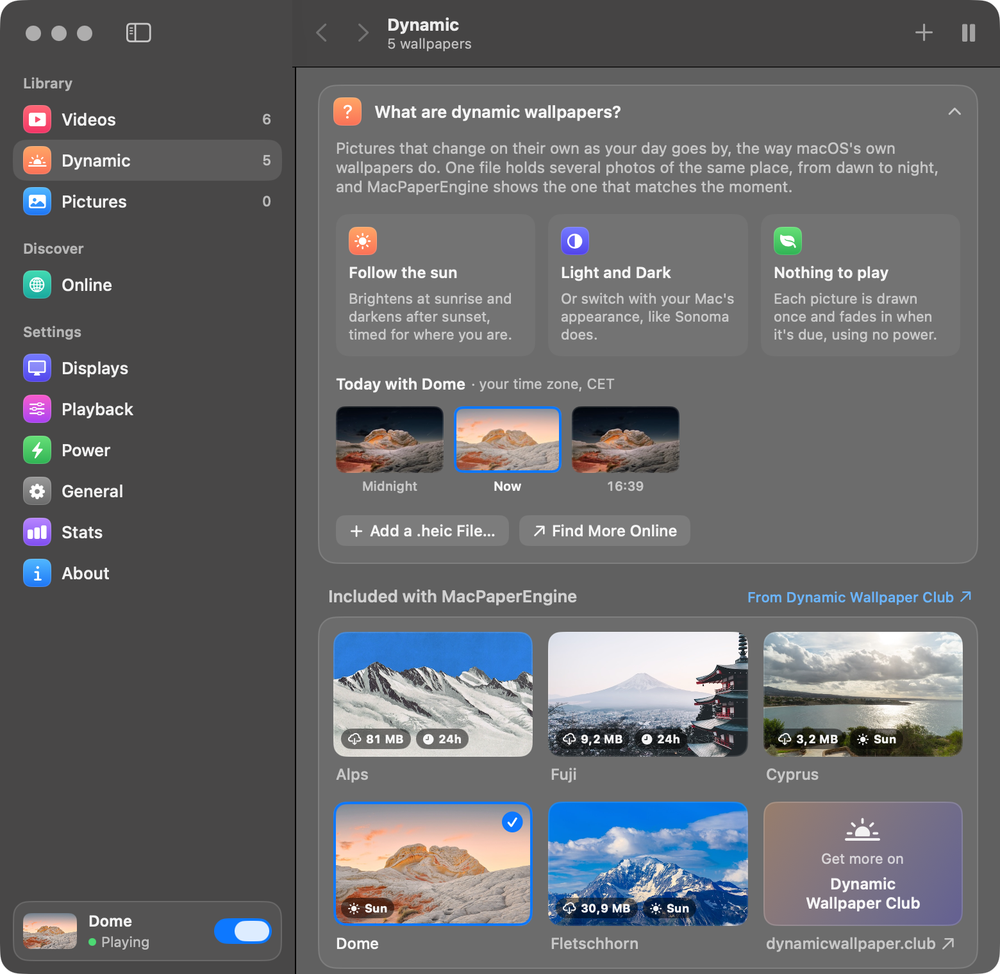

# MacPaperEngine

[](https://github.com/edisadk-pm/MacPaperEngine/releases/latest)
[](#requirements)
[](LICENSE)

Video, dynamic and picture wallpapers for your Mac's desktop and Lock Screen, using as little memory as possible.



## Features

- **Videos**: six abstract loops built in, plus your own videos and GIFs. Loops restart without a
  visible jump.
- **Dynamic wallpapers**: pictures that change with the sun or with Light and Dark mode, like
  macOS's own. Five are built in, and you can add your own `.heic` files.
- **Pictures**: still images, drawn once and using no power while shown.
- **Online**: browse [Wallhaven](https://wallhaven.cc) for pictures and
  [Pexels](https://www.pexels.com) for videos, and set one in a click.
- **Lock Screen**: the same wallpaper on the Lock Screen.
- **Low memory**: about 80 MB while playing a 2560×1664 video, against 112 MB with Apple's
  `AVPlayerLooper`, and 37 to 49 MB for a picture ([how](#why-it-uses-so-little-memory)).
- **Updates itself** from this repository's releases, automatically or only when you say.

## Requirements

- macOS 14 Sonoma or later
- A Mac with Apple silicon or an Intel processor (the app is universal)

## Install

### Disk image

1. Download **[MacPaperEngine.dmg](https://github.com/edisadk-pm/MacPaperEngine/releases/latest/download/MacPaperEngine.dmg)**.
2. Open it and drag **MacPaperEngine** onto **Applications**.
3. Open MacPaperEngine from your Applications folder.

The first time, macOS says it can't verify the app, because MacPaperEngine isn't notarized by
Apple. Close that message, open **System Settings > Privacy & Security**, scroll down to
**Security** and click **Open Anyway** next to MacPaperEngine, then confirm. macOS only asks once.

### Terminal

Or paste this into Terminal:

```sh
curl -fsSL https://raw.githubusercontent.com/edisadk-pm/MacPaperEngine/main/install.sh | bash
```

[The script](install.sh) downloads the latest release, checks it against the SHA-256 checksum
published with it and its code signature, installs it in `/Applications` (or `~/Applications` if
you can't write there) and opens it. Files downloaded this way aren't marked as coming from the
internet, so macOS doesn't ask about it. Running it again updates an existing copy.

## Getting started

1. Open **MacPaperEngine**. The first time, it asks how it should handle [updates](#updates).
2. Click a wallpaper on **Videos**, **Dynamic** or **Pictures**. A built-in downloads the first
   time you pick it (3 to 245 MB), then stays on your Mac. It appears on your desktop, behind your
   icons.
3. Close the window. The wallpaper keeps running: a small background engine draws it, and the
   window's memory goes back to the system.
4. To have the wallpaper come back after a restart, turn on **General > Start Wallpaper at Login**.

To stop the wallpaper, choose **Stop Wallpaper** from the menu bar icon, or press ⌥⌘Q in the app.
On the desktop, MacPaperEngine draws above your system wallpaper, which reappears when it stops.

## Using the app

The window works like System Settings: a sidebar you can hide (⌃⌘S), Back and Forward in the
toolbar, and each page's actions next to its title. The window has a fixed width and can be made
taller.

| Shortcut | Does |
| --- | --- |
| ⌘1 to ⌘9 | Videos, Dynamic, Pictures, Online, Displays, Playback, Power, General, Stats |
| ⌘[ and ⌘] | Back and Forward |
| ⌘O | Add wallpapers to the tab you're on |
| ⌘F | Search online |
| ⌥⌘P | Pause or resume the wallpaper (also in the toolbar and the menu bar icon) |
| ⌥⌘→ and ⌥⌘← | Next and previous wallpaper in the current one's tab |
| ⌘, | Settings |
| ⌥⌘Q | Quit and stop the wallpaper too. Plain ⌘Q leaves the wallpaper running. |

The **Wallpaper** menu also turns the wallpaper off, jumps to the one showing, removes it, and
switches Play on Lock Screen and Hide Loop Jump. **About** (also **MacPaperEngine > About
MacPaperEngine**) shows the version, what's new in it, and credits.

### Adding your own wallpapers

Click **Add** on any library tab, drop files anywhere in the window, or drag them onto the Dock
icon. Each file goes to the tab it belongs in:

| File | Tab |
| --- | --- |
| MP4, MOV, M4V | Videos |
| GIF, animated WebP, APNG | Videos, converted to video on import |
| HEIC with time-of-day or Light/Dark pictures | Dynamic |
| JPEG, PNG, HEIC and other still images | Pictures |

To remove something you added or downloaded, hover over it and click the **×** in its corner, or
right-click it. MacPaperEngine asks first, and deletes only its own copy: the file you added from
your Mac stays where it was. Built-ins can't be removed, but right-clicking one offers **Remove
Download** to free its space, and **General > Downloaded Built-ins > Remove Unused** clears every
one that isn't on screen. They download again when picked.

**Hide Loop Jump** (Playback, on by default) makes a copy of each of your videos whose first
half-second blends in its last, so the restart can't be seen. The copy is made once, in the
background while the window is open, and playback costs nothing extra. Built-in clips already loop
cleanly.

Dynamic wallpapers that follow the sun judge its position from your time zone's reference city in
`/usr/share/zoneinfo/zone.tab`, so no location access is needed. Files that only describe sunrise
run the same pictures in reverse at sunset, and two-picture day-and-night files switch at sunrise
and sunset whatever hours they were saved with. [Dynamic Wallpaper Club](https://dynamicwallpaper.club)
has many more.

### Online

- **Pictures** come from [Wallhaven](https://wallhaven.cc), with no account needed. Only images
  marked safe for work are requested. They're uploaded by Wallhaven's community under mixed
  licences, so check one before sharing it.
- **Videos** come from [Pexels](https://www.pexels.com). Pexels needs a free API key: the Online
  page walks you through getting one and keeps it on your Mac. The file downloaded is the one that
  best matches your display, never larger, because a 4K file costs twice the memory to play.

Only the window process goes online, for browsing, built-in downloads and updates. The engine
never does.

### Lock Screen

macOS draws the Lock Screen itself and hides every app's windows there, so a desktop app can't
appear on it. **Displays > Play on Lock Screen** registers your video as an Aerial in your own
`~/Library/Application Support/com.apple.wallpaper` folder, and macOS plays it from there.
Pictures and dynamic wallpapers need no conversion: they become the system wallpaper directly. No
admin rights are needed.

This changes your system wallpaper while it's on. Turning it off restores your previous choice,
which is kept in `SystemWallpaperBackup.plist` in the app's data folder
(`~/Library/Application Support/MacPaper`).

It isn't a public API. macOS refreshes its Aerial list periodically, which MacPaperEngine detects
and repairs, but a major macOS update could break it.

## Updates

MacPaperEngine updates itself from this repository's
[releases](https://github.com/edisadk-pm/MacPaperEngine/releases). The first time you open it, it
asks how far it should go:

| Choice | Does |
| --- | --- |
| **Automatic** (recommended) | Checks each time you open the window, downloads a new version in the background, and installs it when you close the window |
| **Ask First** | Checks each time you open the window, and asks before downloading |
| **Manual** | Looks only when you choose **MacPaperEngine > Check for Updates…** |

You can change it later in **General > Updates**. Before a download is kept, it's checked against
the SHA-256 checksum published with the release, the app's bundle identifier, the version and the
code signature. When it's ready, the sidebar offers **Restart Now**; otherwise it's swapped in when
you close the window, and the wallpaper is back within a second or two. Only copies in an
`Applications` folder update themselves. What changed in each version is in
[CHANGELOG.md](CHANGELOG.md) and on the app's About page.

## Uninstall

1. In MacPaperEngine, turn off **Displays > Play on Lock Screen** if it's on, so your previous
   system wallpaper comes back, and turn off **General > Start Wallpaper at Login**.
2. Press ⌥⌘Q to quit and stop the wallpaper.
3. Move MacPaperEngine from Applications to the Trash.
4. To remove your library and settings too, run:

   ```sh
   rm -rf ~/Library/Application\ Support/MacPaper
   defaults delete app.macpaper.MacPaper
   ```

## Why it uses so little memory

Two processes, so that the interface costs nothing when you aren't looking at it:

| Process | Runs | Built with |
| --- | --- | --- |
| `MacPaperEngine Helper` | Always, with the wallpaper | AppKit, AVFoundation |
| `MacPaperEngine` | Only while the window is open | SwiftUI |

They share `~/Library/Application Support/MacPaper/state.json` and signal each other with
distributed notifications.

- **Video** is read as compressed samples and fed to a hardware decoder only a few frames ahead of
  the playhead, growing that window only if frames actually drop (`VideoContent.swift`). Decoded
  frames are nearly all of a video's memory cost.
- **Animated images** become video on import, so frames are never all held in memory.
- **Pictures and dynamic wallpapers** are decoded once at the screen's size, so a 6K original
  never sits in memory, and nothing runs until the next picture is due (`StillContent.swift`).
- **Playback stops** when windows cover the desktop, the screen locks or sleeps, in Low Power Mode,
  and optionally on battery (`PowerMonitor.swift`).

Measured on an M2 MacBook Air, engine plus macOS's decoder helper, while playing:

| Wallpaper | MacPaperEngine | `AVPlayerLooper`, for comparison |
| --- | --- | --- |
| 2560×1664 HEVC, 30 fps | about 80 MB | 112 MB |
| 3840×2160 HEVC, 60 fps | about 160 MB | 278 MB |
| Picture or dynamic wallpaper | about 37 to 49 MB | n/a |

macOS decodes video in a separate process, which Activity Monitor lists as `VTDecoderXPCService`.
Count it when comparing. The Stats page in the app includes it.

## Credits

- The six abstract video loops are by [Colin Jones (larchmedia)](https://www.pexels.com/@larchmedia/)
  on Pexels, who makes two-minute abstract loops for backgrounds.
- The five dynamic wallpapers come from [Dynamic Wallpaper Club](https://dynamicwallpaper.club),
  where you'll find many more.
- Online pictures come from [Wallhaven](https://wallhaven.cc) and online videos from
  [Pexels](https://www.pexels.com).

The app credits them on the Videos and Dynamic tabs, in each built-in's tooltip and right-click
menu, and on the About page.

## Building from source

Requires macOS 14 or later and Xcode 26 or later (the app icon is an Icon Composer file).

```sh
./build.sh
open build/MacPaperEngine.app
```

`build.sh` makes a universal `build/MacPaperEngine.app`, ad-hoc signed. A build run from `build/`
never updates itself. For testing, `MACPAPER_HOME=/path/to/folder` runs the app against a throwaway
library, `MACPAPER_UPDATE_FEED` points the updater at another release feed, and
`MACPAPER_MEDIA_URL=file:///path/to/folder/` downloads the built-ins from a local folder.

### Releasing

Add a section for the new version at the top of [CHANGELOG.md](CHANGELOG.md), commit, then:

```sh
Packaging/release.sh 1.2.0
```

The section becomes the release notes on GitHub and **What's New** on the app's About page; its
first paragraph is the line the sidebar shows after updating. The script refuses a version without
one, and needs a clean working tree. It sets the version in both `Info.plist`s, builds, zips the
app with its checksum (what the updater and `install.sh` download), makes the disk image with
`Packaging/make-dmg.sh`, commits "Release 1.2.0", tags `v1.2.0`, pushes and creates the GitHub
release. The disk image's layout is written by [dmgbuild](https://github.com/dmgbuild/dmgbuild),
which `make-dmg.sh` installs into `build/` the first time.

### Built-in media

The full clips and dynamic wallpapers live in `Media/`, which git ignores, and in the
`media-1` release of [macpaper-media](https://github.com/edisadk-pm/macpaper-media). The app ships
only `Resources/*/catalog.json` and small previews. After changing `Media/`:

```sh
Packaging/make-previews.sh
gh release upload media-1 Media/Footage/*.mp4 Media/Dynamic/*.heic \
    --repo edisadk-pm/macpaper-media --clobber
```

`make-previews.sh` regenerates the previews and the file sizes in the catalogs.

## License

[MIT](LICENSE) © 2026 Edi Sadikaj
